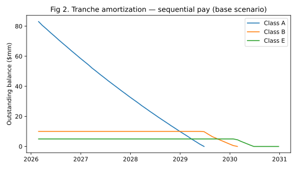
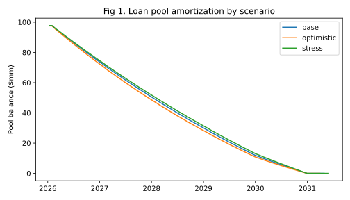
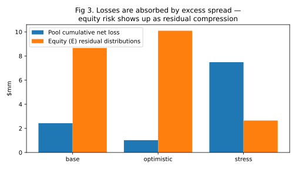

# Auto ABS Cash Flow Modeling & Credit Stress Testing

A simplified, fully reproducible auto-loan securitization model built with
[AbsBox](https://github.com/yellowbean/AbsBox) (Python) on the Hastructure
cash-flow engine. It models a $100mm auto-loan pool, a three-tranche
senior-subordinate structure with a sequential-pay waterfall, and evaluates
tranche performance under base / optimistic / stress collateral scenarios
and a CDR × CPR sensitivity grid.

> **Scope & honesty note.** All collateral is *synthetic* (three representative
> loan segments, not loan-level real data) and the structure is a simplified
> amortizing deal. Results below are outputs of this model only — they are
> **not** the results of any real transaction and not a rating-agency model.
> A real-world benchmark modelled in the AbsBox documentation is the
> BMW Auto Deal 2023-01 (a revolving structure with materially more features).

中文说明见 [README_CN.md](README_CN.md).

## Transaction structure

| Component | Terms |
|---|---|
| Collateral pool | $100mm auto loans, 3 `Installment` rep lines: prime $50mm / near-prime $30mm / subprime $20mm |
| Class A (senior) | $85mm, 5.00% fixed, sequential |
| Class B (mezzanine) | $10mm, 7.50% fixed, sequential |
| Class E (equity) | $5mm, no coupon, receives residual cash flow |
| Subordination | 15% beneath Class A (B + E) |
| Fees | Servicing 1.00% p.a. on pool balance; trustee fixed fee $25,000 |
| Waterfall (monthly) | Fees → A interest → B interest → A principal → B principal → E principal → residual to E |

Collateral performance assumptions are expressed as **CDR** (annual default
rate), **CPR** (annual prepayment rate), recovery rate and recovery lag,
applied by the engine at loan level.



*Sequential pay in the base scenario: Class A amortizes first while B and E
stay constant; B amortizes only after A is repaid, then E.*

## Results (actual engine run, 2026-11-10)

| Scenario | CDR / CPR / Recovery / Lag | Pool cum. net loss | A WAL | B WAL | E principal loss | E yield* |
|---|---|---|---|---|---|---|
| Base | 1.5% / 8% / 35% / 4m | $1.97mm | 1.66y | 3.77y | $0 | +8.61% |
| Optimistic | 0.8% / 12% / 45% / 3m | $0.82mm | 1.56y | 3.69y | $0 | +6.84% |
| Stress | 4.0% / 5% / 25% / 6m | $6.19mm | 1.78y | 4.06y | **$2.03mm (40.6%)** | −10.91% |

\* Yield = IRR of buying the tranche at par at closing and holding to
maturity (effective annual). Class A yields ≈ 5.20% and Class B ≈ 7.83% in
**all** scenarios — both are repaid in full even under stress. Full table:
`outputs/yield_summary.csv`; cash flows: `outputs/bond_*_flow_*.csv`.

**Key findings**

1. **Subordination works as designed.** Under stress the pool loses $6.19mm,
   excess spread absorbs roughly $4.2mm, and the remaining $2.03mm loss stops
   at the equity tranche. Classes A and B are untouched.
2. **Higher prepayment can *hurt* the equity tranche.** In the CDR × CPR grid
   (`outputs/sensitivity_grid.csv`), raising CPR increases equity losses:
   prepaid loans stop paying fees, excess spread thins, and less cushion is
   left to absorb defaults. Class B only takes a loss in the extreme corner
   (CDR 5% × CPR 15%, $1.54mm).





## How to run

Version alignment matters (AbsBox rule: the Python package and the engine
must share the same minor version). Verified combination:
**absbox 0.50.3 + Hastructure 0.50.2**, run locally — the public engine at
absbox.org returned 502 Bad Gateway on 2026-11-10.

```bash
python3 -m venv .venv && source .venv/bin/activate
pip install -r requirements.txt

# terminal 1 — local engine (script downloads the binary on first run)
bash engine/start_engine.sh            # http://localhost:8081

# terminal 2
python src/run_scenarios.py            # scenarios -> outputs/
python src/sensitivity.py              # CDR x CPR grid
python src/pricing.py                  # tranche yields at par
python src/make_figures.py             # figures (SVG + PNG)
```

## Repository layout

```
src/auto_abs_deal.py   deal definition: pool, tranches, fees, waterfall, scenarios
src/run_scenarios.py   base / optimistic / stress runs; WAL & loss summary
src/sensitivity.py     CDR x CPR sensitivity grid
src/pricing.py         tranche yield (IRR at par) from engine cash flows
src/make_figures.py    figures from the engine outputs
engine/start_engine.sh local Hastructure engine launcher
outputs/               engine cash flows (CSV), scenario & yield summaries
figures/               charts generated from outputs/
```

## Limitations & next steps

- Synthetic representative segments share one set of CDR/CPR assumptions;
  segment-level assumptions (higher CDR for subprime) are the first extension.
- No cumulative-loss trigger, reserve account, or revolving period yet —
  each is a documented next step, in that order.
- The `Installment` asset charges a **flat monthly fee on the original
  balance** (engine-verified), so segment fee rates were calibrated as
  monthly flat fees, not APRs. A loan-level amortizing treatment is a
  possible refinement.
- Benchmarking against a real transaction (e.g. BMW 2023-01 in the AbsBox
  docs, or a presale report's capital structure) is planned as a
  comparison layer, kept strictly separate from this synthetic model.
